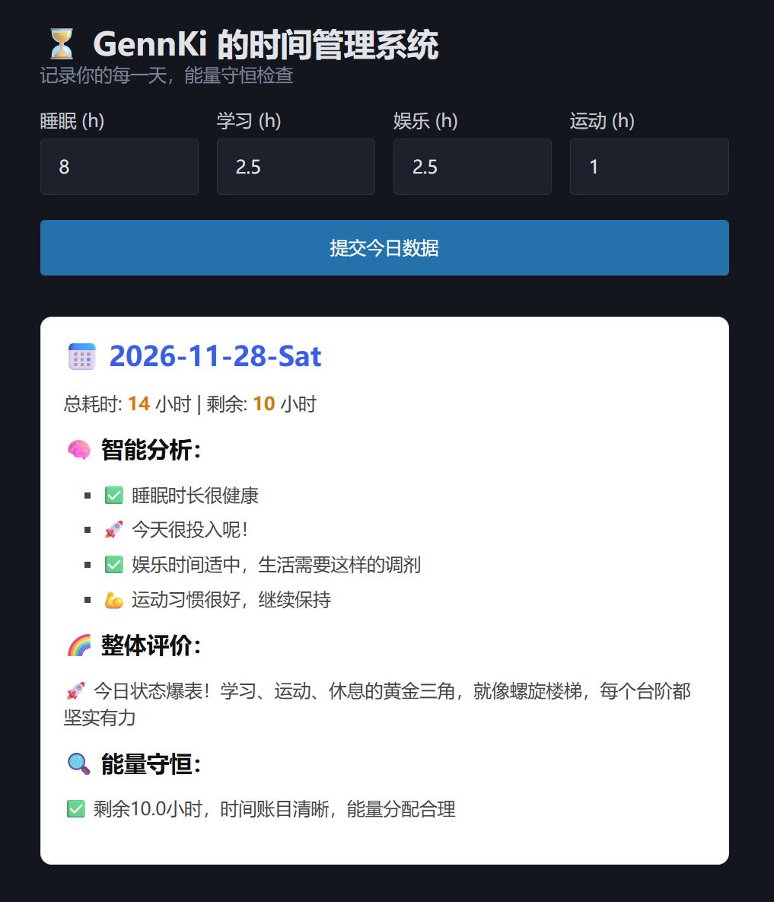
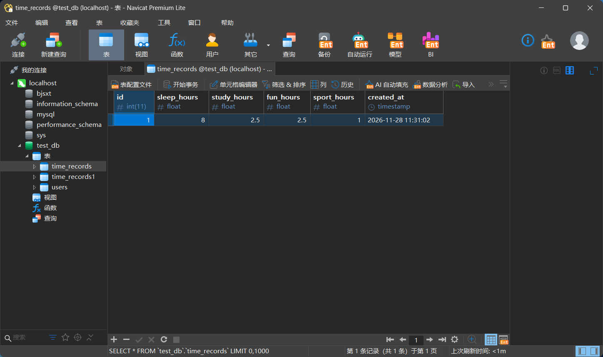
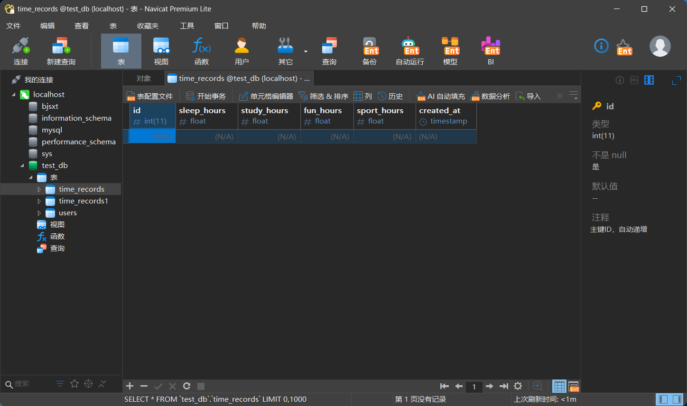

# ⏳ GennKi's Time Tracker (全栈版)

这是一个基于 Python 后端与原生 Web 前端构建的时间管理系统。项目融合了面向对象的数据建模、RESTful API 设计、MySQL 持久化以及智能数据分析。

前端界面截图：



提交后数据表截图：



## ✨ 核心功能

**数据录入**：前端表单输入当天的睡眠、学习、娱乐、运动时长。

**智能分析**：后端基于自定义的业务规则（如阈值判断）自动生成当天的状态评估报告。

**能量守恒检查**：通过流体力学（输入-处理-输出）的底层逻辑，检测未记录的时间（时间黑洞）。

**数据持久化**：所有记录自动落盘至本地 MySQL 数据库。

## 🛠️ 技术栈

**后端**：Python / Flask / PyMySQL

**前端**：HTML5 / Fetch API / Pico.css

**数据库**：MySQL

**工程化**：python-dotenv (环境变量隔离) / Git

## 📁 项目结构

```text
time-tracker-fullstack/
├── core/                # 核心业务逻辑模块
│   ├── analyzer.py      # 智能分析逻辑
│   ├── data_manager.py  # 旧版CSV数据管理 (可标注已废弃)
│   └── input_handler.py # 旧版终端输入处理
├── templates/           # 前端页面
│   └── index.html       # 主页面
├── docs/                # 文档
│   └── screenshot.png   # 前端界面截图
│   └── db-0.png         # 提交后数据表截图
│   └── db-1.png         # 数据表初始化截图
├── app_time.py          # Flask 后端主程序
├── models.py            # 面向对象数据模型 (每日记录类)
├── config.py            # 阈值配置类
├── .env.example         # 环境变量配置模板
├── requirements.txt     # 依赖清单
└── README.md
```

## 🚀 快速启动指南

**1. 环境准备**
确保本地已安装 Python 3.10+ 和 MySQL。

**2. 克隆项目并配置虚拟环境**

```bash
git clone https://github.com/gennki-mxh/gennki-time-tracker-fullstack
cd gennki-time-tracker-fullstack
python -m venv venv
# Windows 激活
.\venv\Scripts\activate
# macOS/Linux 激活
source venv/bin/activate
```

**3. 安装依赖**

```bash
pip install -r requirements.txt
```

**4. 配置环境变量**

复制 `.env.example` 重命名为 `.env`，并填入你的真实数据库配置：

```text
DB_HOST='127.0.0.1'
DB_USER='root'
DB_PASSWORD='你的数据库密码'
DB_NAME='test_db'
```

> 确保密钥不入库，在 `.gitignore` 添加 `.env`。

**5. 初始化数据库表**
在启动项目前，请先在你的 MySQL 数据库中创建一张名为 `time_records` 的表。

如果你已经拥有本地数据库，则执行如下 SQL 语句来初始化数据表：

```sql
CREATE TABLE time_records (
    id INT AUTO_INCREMENT PRIMARY KEY COMMENT '主键ID，自动递增',
    sleep_hours FLOAT NOT NULL DEFAULT 0 COMMENT '睡眠时长(小时)',
    study_hours FLOAT NOT NULL DEFAULT 0 COMMENT '学习时长(小时)',
    fun_hours FLOAT NOT NULL DEFAULT 0 COMMENT '娱乐时长(小时)',
    sport_hours FLOAT NOT NULL DEFAULT 0 COMMENT '运动时长(小时)',
    created_at TIMESTAMP DEFAULT CURRENT_TIMESTAMP COMMENT '记录创建时间'
) ENGINE=InnoDB DEFAULT CHARSET=utf8mb4 COLLATE=utf8mb4_unicode_ci COMMENT='每日时间记录表';
```

数据表初始化截图：



如果想要了解从创建数据库到初始化数据表的全过程，请转到文末。

**6. 启动项目**

```bash
python app_time.py
```

访问 `http://127.0.0.1:5000` 即可看到页面。

## 💡 细节说明

**为什么使用 `.env`？** 确保数据库密钥不会随着 Git 提交到公共仓库。

**架构演进**：项目最初是纯终端脚本（使用 CSV），后来重构成了 Web API 架构，体现了从脚本到工程化的演进。

**异常处理**：在 API 层捕获了 `pymysql` 的异常，避免数据库宕机导致服务崩溃。

## 🗄️ 数据库初始化指南

本项目使用 MySQL 作为数据持久化存储。在启动后端服务前，请确保你的 MySQL 服务已启动。
*(注：本文假设你已安装并配置好 MySQL 环境，以下操作均在 MySQL 命令行客户端或 Navicat 的查询窗口中依次执行)*

### 步骤 1：创建数据库

如果你的本地还没有对应的数据库，请执行以下 SQL 语句来创建一个名为 `test_db` 的数据库，并指定字符集为 `utf8mb4`（支持存储 Emoji 表情等特殊字符），排序规则为 `utf8mb4_unicode_ci`：

```sql
CREATE DATABASE IF NOT EXISTS test_db DEFAULT CHARACTER SET utf8mb4 COLLATE utf8mb4_unicode_ci;
```

### 步骤 2：选择数据库

创建完成后，需要切换到该数据库才能进行后续的表操作：

```sql
USE test_db;
```

### 步骤 3：创建数据表

本项目核心的数据表名为 `time_records`，用于存储每日的时间分配记录。执行以下 SQL 语句创建该表：

```sql
CREATE TABLE time_records (
    id INT AUTO_INCREMENT PRIMARY KEY COMMENT '主键ID，自动递增',
    sleep_hours FLOAT NOT NULL DEFAULT 0 COMMENT '睡眠时长(小时)',
    study_hours FLOAT NOT NULL DEFAULT 0 COMMENT '学习时长(小时)',
    fun_hours FLOAT NOT NULL DEFAULT 0 COMMENT '娱乐时长(小时)',
    sport_hours FLOAT NOT NULL DEFAULT 0 COMMENT '运动时长(小时)',
    created_at TIMESTAMP DEFAULT CURRENT_TIMESTAMP COMMENT '记录创建时间'
) ENGINE=InnoDB DEFAULT CHARSET=utf8mb4 COLLATE=utf8mb4_unicode_ci COMMENT='每日时间记录表';
```

> 💡 **细节说明**：使用 `FLOAT` 类型是为了兼容 `3.5` 这样的半小数时长；加入 `created_at` 字段可以记录数据入库的准确时间。

### 步骤 4：验证表结构

执行完建表语句后，可以使用以下命令来确认表是否创建成功，并查看字段定义：

```sql
DESCRIBE time_records;
```

如果终端返回了包含 `id`、`sleep_hours` 等字段的表格，恭喜你，数据库环境已准备就绪！你可以继续启动 Flask 项目了。

---

***Created by [GennKi](https://gennki-mxh.github.io/)***
